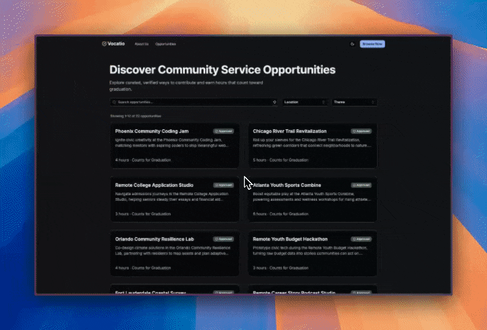

# Vocatio

[](#)
[](https://www.python.org/)
[](https://nextjs.org/)

Vocatio helps high-school students discover meaningful community service opportunities while giving local organizations a simple way to reach engaged volunteers.

> Building the go-to extracurricular companion for students pursuing graduation-required service hours.

## Demo



## Why It Matters

- Students struggle to find verified, high-impact service work that fits their schedules.
- Schools and community organizations lack a modern, student-friendly storefront for volunteer roles.
- Vocatio bridges that gap with curated listings, communication tools, and lightweight tracking.

## Highlights

- Personalized browsing with filters for location, themes, and community-hour counts.
- Opportunity importer and waitlist workflows built in FastAPI with async background tasks.
- Responsive Next.js web experience designed for mobile-first student usage.

## Architecture at a Glance

- **Backend** — FastAPI + SQLModel service layer, Alembic migrations, PostgreSQL (SQLite for local dev/tests).
- **Frontend** — Next.js (App Router), React 19, Tailwind-based component system.
- **Tooling** — Docker Compose, Ruff, Pytest, GitHub Actions-ready workflow (tests + lint).

```text
.
├── backend
│   ├── app
│   │   ├── api          # FastAPI routes & dependencies
│   │   ├── cli          # management commands (imports, maintenance)
│   │   ├── core         # settings, auth, utilities
│   │   ├── db           # session management
│   │   ├── models       # SQLModel definitions
│   │   ├── schemas      # Pydantic I/O contracts
│   │   ├── services     # domain logic & background jobs
│   │   └── templates    # transactional email templates
│   ├── data             # CSV templates & sample content
│   └── tests
└── frontend
    ├── public
    └── src
        ├── app
        │   ├── opportunities
        │   │   └── _components/__tests__
        │   └── about-us, shared layout primitives
        ├── components/ui
        ├── hooks         # reusable client hooks
        └── lib           # client utilities
```

## Getting Started

### Prerequisites

- Python 3.11+
- Node.js 20+
- Docker (optional, for containerized dev or prod-like verification)

### Backend API

```bash
cd backend
python -m venv .venv && source .venv/bin/activate
pip install -r requirements.txt
touch .env  # populate using the sample below
alembic upgrade head
uvicorn app.main:app --reload
```

OpenAPI docs live at `http://127.0.0.1:8000/docs`.

### Frontend Web App

```bash
cd frontend
npm install
touch .env  # populate using the sample below
npm run dev
```

Visit `http://localhost:3000` for the UI.

### Environment Variables

- `backend/.env`
  - `DATABASE_URL` — PostgreSQL in production; `sqlite:///./dev.db` for quickstart.
  - `FRONTEND_URL` — Allowed CORS origin (e.g., `http://localhost:3000`).
  - `POSTMARK_API_TOKEN` / `POSTMARK_FROM_EMAIL` — optional email confirmations.
- `frontend/.env`
  - `NEXT_PUBLIC_BACKEND_URL` — API base URL exposed to the client.

Never commit real secrets; rely on `.env` files locally and secret managers in deployment.

<details>
<summary>Sample env files</summary>

```env
# backend/.env
DATABASE_URL=sqlite:///./dev.db
DATABASE_ECHO=false
FRONTEND_URL=http://localhost:3000

# Optional email confirmations via Postmark
POSTMARK_API_TOKEN=
POSTMARK_FROM_EMAIL=
```

```env
# frontend/.env
NEXT_PUBLIC_BACKEND_URL=http://127.0.0.1:8000
```

</details>

## Docker Workflow

- **Dev mode**: `docker compose up`
  - Backend: `http://localhost:8000` with automatic reloads.
  - Frontend: `http://localhost:3000` running `next dev`.
- **Prod-like check**: `docker compose -f docker-compose.prod.yml up --build`
  - Builds static assets and runs the API with gunicorn-compatible settings.

## Testing & Quality

- Backend unit tests: `cd backend && pytest -q`
- Frontend component tests: `cd frontend && npm test`
- Linting & formatting: `ruff check backend/app`, `ruff format backend/app`, `cd frontend && npm run lint`

Automated tests use an in-memory SQLite database and create tables via SQLModel metadata (Alembic is Postgres-only and skipped in tests).

## License

Released under the [MIT License](./LICENSE).
